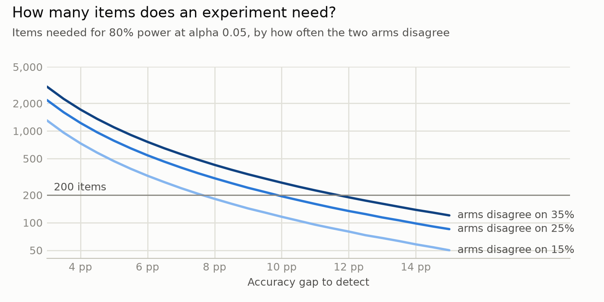
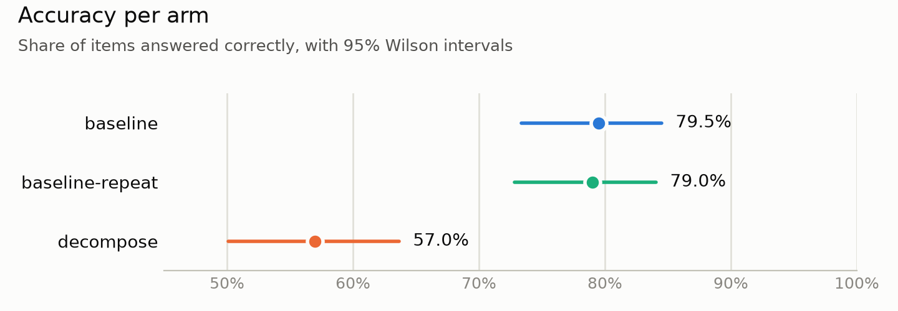
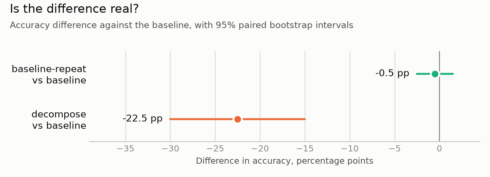
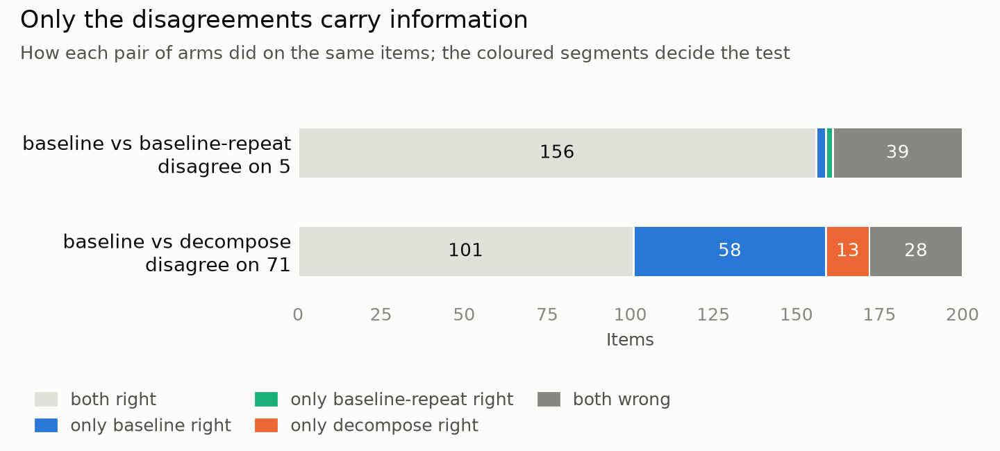
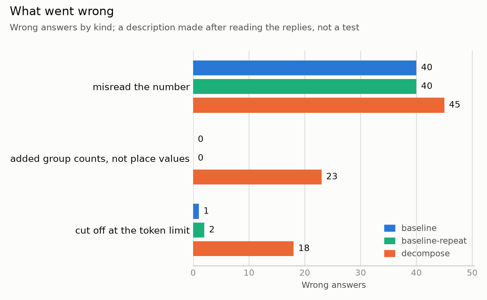
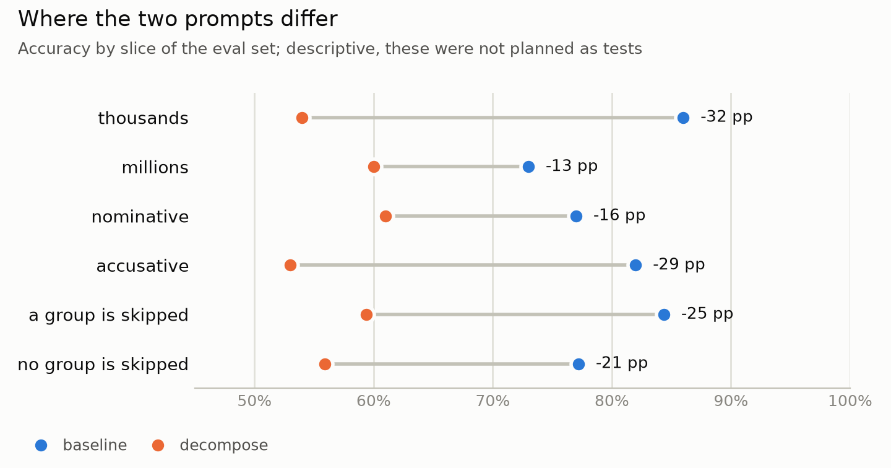

# LLM experiment statistics

"Prompt B scored 87%, prompt A scored 83%, so B is better." On 200 eval items that
conclusion is often wrong: a four-point gap is well inside what the same prompt
produces when you simply run it twice.

This repository is a small, tested toolkit for answering the question properly — is
variant B actually better than variant A, and by how much? — together with one
experiment run end to end as an example.

## The method

**1. Pair the outcomes.** Both variants answer the same items, so the comparison is
paired. Items both variants get right, or both get wrong, say nothing about which is
better; only the items where they disagree do. An unpaired test throws that structure
away and needs several times more items to see the same effect.

**2. Test with McNemar's exact test.** Under the null hypothesis a disagreement is
equally likely to favour either variant, so the split of the disagreements is
Binomial(n, 0.5). No normal approximation, which matters because the number of
disagreements is usually small.

**3. Report an interval, not only a p-value.** A paired bootstrap resamples items —
each item brings both of its answers — and gives a 95% interval for the accuracy
difference. "Somewhere between +1 and +9 points" is what a decision needs.

**4. Measure the noise floor with an A/A arm.** The baseline prompt is run twice. Any
difference between those two runs is noise, and it shows how large a difference noise
alone produces with this model, this temperature and this many items.

**5. Plan the comparisons, then correct for making several.** The comparisons are
written down in [`experiment.py`](src/llm_ab/experiment.py) before any model is
called, and their p-values are Holm-adjusted. Slices of the data (by difficulty, by
grammatical case) are reported as description, not as tests.

**6. Decide the sample size first.** How many items an experiment needs depends on how
often the variants disagree, not only on the gap between them:

| Only A right | Only B right | Gap | Items needed (80% power, alpha 0.05) |
|---:|---:|---:|---:|
| 2% | 12% | 10 pp | 108 |
| 5% | 15% | 10 pp | 155 |
| 10% | 20% | 10 pp | 234 |
| 5% | 10% | 5 pp | 469 |
| 10% | 15% | 5 pp | 783 |

A 200-item eval can confirm a ten-point improvement. It cannot confirm a five-point one.

<picture>
  <source media="(prefers-color-scheme: dark)" srcset="docs/figures/sample-size-dark.png">
  
</picture>

All of this lives in [`stats.py`](src/llm_ab/stats.py), about 150 lines with no
dependency beyond NumPy. Each function is tested against a hand calculation or a
published value, and the sample-size formula is checked by simulation.

## The example experiment

**Task.** A Lithuanian sentence states a sum of money in words; the model returns it
in digits.

> Per 2023 metus klientai sumokėjo šimtą keturiasdešimt keturis milijonus septynis
> šimtus septyniasdešimt keturis tūkstančius eurų.
> → `144774000`

The items are generated from the numbers ([`numerals.py`](src/llm_ab/numerals.py)), so
every one has an exact answer with no labelling step. Lithuanian makes the task less
trivial than it looks: numerals and the nouns they count change form with grammatical
case and with the last digits of the number, and each sentence also contains a year in
digits that is not the answer. The 200 items are balanced over case (nominative,
accusative) and magnitude (thousands, millions); in about a third, a whole group is
absent from the words, as in 2 000 017.

**Variants.** Both prompts require the same output format, so one thing differs:

- `baseline` — states the task.
- `decompose` — also asks the model to write out millions, thousands and the remainder
  in digits before adding them, and says that the year is not part of the sum.

The system prompts, exactly as sent ([`experiment.py`](src/llm_ab/experiment.py)). The
user message is the sentence alone, and is the same for every arm.

`baseline`:

```text
Sakinyje pinigų suma parašyta žodžiais.
Paskutinėje atsakymo eilutėje parašyk sumą skaitmenimis tokiu formatu:
ATSAKYMAS: <skaičius be tarpų ir be valiutos>
```

> The sentence states a sum of money in words. On the last line of the reply write the
> sum in digits in this format: ATSAKYMAS: \<number without spaces or currency\>

`decompose`:

```text
Sakinyje pinigų suma parašyta žodžiais.
Prieš atsakydamas atskirai užrašyk skaitmenimis milijonus, tūkstančius ir likutį, tada juos sudėk. Jei kurios nors dalies sakinyje nėra, ji lygi nuliui. Sakinyje esantys metai nėra sumos dalis.
Paskutinėje atsakymo eilutėje parašyk sumą skaitmenimis tokiu formatu:
ATSAKYMAS: <skaičius be tarpų ir be valiutos>
```

> The same, with one paragraph added in the middle: before answering, write out the
> millions, the thousands and the remainder in digits separately, then add them. If a
> part is absent from the sentence, it is zero. The year in the sentence is not part of
> the sum.

**Arms.** `baseline`, `baseline-repeat` (the A/A arm) and `decompose`.

**Scoring.** Fixed before any model was called and identical for every arm
([`scoring.py`](src/llm_ab/scoring.py)): the number on the last `ATSAKYMAS:` line must
equal the answer. A reply that ignores the format is wrong, and is counted separately
so that a format problem is not mistaken for a reading problem.

## Results

`openai/gpt-oss-20b` on Groq, temperature 0, 200 items per arm, run on 22–24 November
2026. The full tables are in [`docs/results.md`](docs/results.md) and every reply is in
[`runs/`](runs/).

<picture>
  <source media="(prefers-color-scheme: dark)" srcset="docs/figures/accuracy-dark.png">
  
</picture>

| Arm | Correct | Accuracy | 95% CI (Wilson) |
|---|---:|---:|---|
| `baseline` | 159 | 79.5% | 73.4% to 84.5% |
| `baseline-repeat` | 158 | 79.0% | 72.8% to 84.1% |
| `decompose` | 114 | 57.0% | 50.1% to 63.7% |

### The "better" prompt is worse

<picture>
  <source media="(prefers-color-scheme: dark)" srcset="docs/figures/differences-dark.png">
  
</picture>

| A | B | Only A right | Only B right | Difference | 95% CI (bootstrap) | p (Holm) |
|---|---|---:|---:|---:|---|---:|
| `baseline` | `baseline-repeat` | 3 | 2 | -0.5 pp | -2.5 pp to +1.5 pp | 1.0000 |
| `baseline` | `decompose` | 58 | 13 | -22.5 pp | -30.0 pp to -15.0 pp | < 0.0001 |

Asking the model to write out millions, thousands and the remainder before answering
cost 22.5 points. The interval excludes zero by a wide margin, and the A/A pair shows
what no effect looks like on the same scale.

### The test is decided by the items where the arms disagree

<picture>
  <source media="(prefers-color-scheme: dark)" srcset="docs/figures/paired-outcomes-dark.png">
  
</picture>

The two runs of the same prompt disagreed on 5 of 200 items, 3 one way and 2 the other,
at temperature 0 (187 of the 200 replies were identical word for word). That is the
noise floor: a gap of a point or two between two prompts on this setup would be
indistinguishable from running one prompt twice. The two prompts disagreed on 71 items,
and the baseline won 58 of them.

### Why it is worse

<picture>
  <source media="(prefers-color-scheme: dark)" srcset="docs/figures/errors-dark.png">
  
</picture>

Reading the wrong replies, after the test, explains nearly the whole gap. The
decomposition prompt did not make the model read numbers worse: it misread about as
many as the baseline, 45 against 40. It added two ways to fail that the baseline does
not have.

- **23 replies added the group counts instead of the place values.** For 257 121 the
  model wrote `TUKSTANCIUS: 257`, `LIKUTIS: 121`, `ATSAKYMAS: 378`. It read every group
  correctly and then did what the prompt literally says: write the thousands in
  digits, then add. The instruction was ambiguous, and the model resolved it the wrong
  way about one time in nine.
- **18 replies were cut off at the 2048-token limit.** The model reasons before it
  answers, and the longer prompt roughly tripled that reasoning (a median of 713
  reasoning tokens against 246), so some replies ran out before the answer line.
  Leaving out the 19 items where either arm was truncated, `decompose` is still 18.8
  points behind (bootstrap interval -26.5 pp to -11.0 pp).

So the finding is narrower than "decomposition hurts": this wording of it, on this
model, at this token limit, introduced two new failure modes that cost more than the
instruction was meant to save. The error kinds were defined after seeing the replies
and are a description, not a test.

### Where it loses

<picture>
  <source media="(prefers-color-scheme: dark)" srcset="docs/figures/slices-dark.png">
  
</picture>

The drop is larger on thousands than on millions, and larger in the accusative than in
the nominative. These slices were not planned as tests.

## Running it

```bash
uv sync
uv run pytest
```

To run the experiment, copy `.env.example` to `.env` and point it at any
OpenAI-compatible endpoint (Groq, OpenRouter, vLLM, Ollama):

```bash
uv run python -m llm_ab.runner
```

```bash
uv run python -m llm_ab.report --out docs/results.md --plots docs/figures
```

The runner sends each item to every arm in turn, logs its progress, and waits out rate
limits. It appends every reply to `runs/<arm>.jsonl` and skips items it has already
recorded, so an interrupted run resumes where it stopped. The report reads only those
files: the analysis can be rerun and checked without calling a model again.

To regenerate the eval set, or make a larger one:

```bash
uv run python -m llm_ab.items --n 200 --seed 0
```

## Limits

- One task, one language, generated items. The method transfers; the numbers do not.
- Right-or-wrong outcomes only. Graded scores from an LLM judge need different tests
  (a paired bootstrap still works; McNemar does not).
- One wording per variant. The decomposition instruction turned out to be ambiguous
  (see "Why it is worse"), and it was tried on only five items before the run. A
  clearer wording might help; this experiment cannot say, and rewording it now and
  rerunning on the same 200 items would be tuning on the test set.
- One model, one run per arm. The result says that this decomposition prompt hurts
  `openai/gpt-oss-20b` at this token limit; a five-item pilot on another model pointed
  the other way, and nothing here says which holds there.
- In the published run the arms ran one after another, and a daily rate limit stretched
  the `decompose` arm over a day and a half. A change on the provider's side during that
  time would be confounded with the prompt; the A/A arm bounds this only for the first
  two hours. The runner has since been changed so that the arms take turns on each
  item, which removes this confound from any new run.
- Items are treated as independent. If an eval set has clusters — several questions
  about one document — the bootstrap has to resample clusters, not items.

## Where this started

[`classic/`](classic/) holds the two notebooks this repository began as: A/B tests on a
fast-food marketing campaign and on the Cookie Cats mobile game, with sample-ratio
checks, bootstrap and analytical intervals, ANOVA and Tukey's test. The statistics are
the same; the experimental unit changed from a customer to an eval item.

## License

The code, the generated eval set and the recorded replies are under the
[MIT License](LICENSE). The two CSV files in [`classic/datasets/`](classic/datasets/)
are third-party datasets and are not covered by it.
